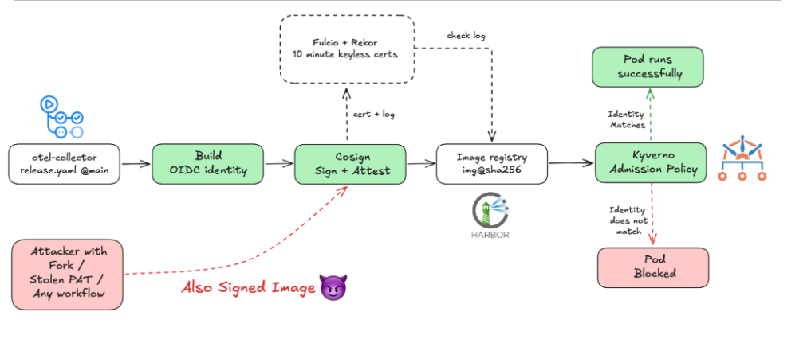

# Who Signed This?

**A valid signature proves almost nothing.**

`cosign verify` passes and admission passes, but that only tells you *someone* signed the image.
It doesn't tell you the image was built by **your** pipeline, from **your** repo, on **your** protected branch.

This repo is a small, reproducible demo of closing that gap with keyless Sigstore signing in
GitHub Actions and a Kyverno `verifyImages` policy that checks **who** signed, not just **whether** it was signed.



```
ci-debug.yaml  ──sign──┐                          ┌─ identity ≠ release.yaml →  Pod blocked
                       ├─> ghcr.io/…@sha256:abc ──┤
release.yaml   ──sign──┘   (same digest)          └─ identity = release.yaml@main → admitted
```


The same image digest gets two valid signatures, both recorded in Rekor. One is rejected and one
is admitted. The only difference is which workflow produced the signature.

---

## How it works

| Piece | What it does |
|---|---|
| `.github/workflows/release.yaml` | The **trusted** path. Runs on push to `main`, builds with ko, and signs keyless (GitHub OIDC token → short-lived Fulcio certificate → Rekor entry). There's no key material anywhere. |
| `.github/workflows/ci-debug.yaml` | The **"attacker"**. Builds the same code and signs it the same way, but from a different workflow file, triggered with `workflow_dispatch`. It stands in for a stolen PAT, a rogue workflow or a compromised maintainer. |
| `policy/require-release-workflow.yaml` | A Kyverno `ClusterPolicy` that only admits images whose certificate identity matches `release.yaml` on `refs/heads/main` in this repo, issued by GitHub, with trigger `push`. |
| `policy/break-glass.yaml` | A narrow `PolicyException` for emergency deploys. It's scoped to `hotfix-*` pods, tagged with an incident annotation, and deletes itself after 2 hours. |
| `.ko.yaml` | Pins the base image by digest. Because ko builds are reproducible, both workflows produce the **identical digest** from the same source. |
| `demo.sh` | Interactive walkthrough. Press Enter to move through each step. |

### What each identity field actually asserts

| Certificate field | Policy value | It proves... |
|---|---|---|
| Issuer | `https://token.actions.githubusercontent.com` | the identity came from GitHub Actions, not someone's laptop |
| Subject | `https://github.com/OWNER/signed-is-not-enough/.github/workflows/release.yaml@refs/heads/main` | **which workflow file**, in **which repo**, at **which ref** |
| `githubWorkflowRepository` | `OWNER/signed-is-not-enough` | the run happened in this repo, not in a fork |
| `githubWorkflowTrigger` | `push` | it wasn't started by hand (`workflow_dispatch`) |
| `githubWorkflowRef` | `refs/heads/main` | it was built from the protected branch |

---

## Prerequisites

- A GitHub account and the `gh` CLI (logged in)
- A container runtime for kind: Docker Desktop, OrbStack, Colima, or Rancher Desktop. Give it **at least 4 GB RAM**.
- CLI tools: `kind`, `kubectl`, `helm`, `cosign`, `jq`, `ko`, `crane`

**macOS**
```bash
brew install kind kubectl helm cosign jq gh ko crane
```

**Windows:** use **WSL2** (Ubuntu) with Docker Desktop's WSL integration turned on, and install the tools inside WSL.
Clone the repo into the WSL filesystem (`~/…`), **not** `/mnt/c/…`. Otherwise Git may convert `demo.sh` to
Windows line endings and you'll get `bad interpreter` errors. PowerShell and Git Bash aren't supported.

**Linux:** install the tools with your package manager or from their release pages.

---

## Setup

### 1. Fork / copy the repo and set your identity

Replace `OWNER` with your GitHub username or org everywhere it appears:

```bash
grep -rl 'OWNER/REPO\|OWNER/signed-is-not-enough' . | xargs sed -i.bak 's#OWNER/REPO#YOUR_USER/signed-is-not-enough#g; s#OWNER/signed-is-not-enough#YOUR_USER/signed-is-not-enough#g'
find . -name '*.bak' -delete
```

Files that need it: `go.mod`, `policy/require-release-workflow.yaml`.

> ⚠️ Use lowercase. GHCR image names must be lowercase.

### 2. Pin the base image

```bash
crane digest cgr.dev/chainguard/static:latest
```
Paste the digest into `.ko.yaml` in place of `REPLACE_ME`.

### 3. Push to `main` once

This runs `release.yaml` and creates the GHCR package. Then go to **GitHub → Packages → signed-is-not-enough → Package settings** and make the package **public**, so kind and Kyverno can pull it without credentials.

### 4. Create the cluster and install Kyverno

```bash
kind create cluster --name sig-demo
helm repo add kyverno https://kyverno.github.io/kyverno && helm repo update
helm install kyverno kyverno/kyverno -n kyverno --create-namespace -f cluster/kyverno-values.yaml
kubectl -n kyverno rollout status deploy/kyverno-admission-controller
kubectl create ns demo
kubectl create ns kyverno-exceptions
kubectl apply -f policy/require-release-workflow.yaml
```

`cluster/kyverno-values.yaml` turns off Kyverno's image-verification cache so a newly re-signed image is checked again straight away.
**Leave the cache on in production.**

---

## Running the demo

You need a digest that **only `ci-debug.yaml` has signed**. Every run needs a fresh source change, because once
`release.yaml` signs a digest, that digest is admitted from then on.

```bash
# 1. New branch with a small code change
git checkout -b demo-1
sed -i.bak 's/verified build/verified build (run 1)/' cmd/app/main.go && rm cmd/app/main.go.bak
git commit -am "demo run 1" && git push -u origin demo-1

# 2. Sign it with the "wrong" workflow
gh workflow run ci-debug --ref demo-1
gh run watch "$(gh run list -w ci-debug -L1 --json databaseId -q '.[0].databaseId')"
# copy the image digest from the run summary

# 3. (optional) an unsigned image for the break-glass step
KO_DOCKER_REPO=ghcr.io/YOUR_USER/signed-is-not-enough ko build ./cmd/app --bare --tags hotfix

# 4. Go
export IMG=ghcr.io/YOUR_USER/signed-is-not-enough@sha256:...
export REPO=YOUR_USER/signed-is-not-enough
export BRANCH=demo-1
./demo.sh
```

### What you'll see

| Step | Command | Result |
|---|---|---|
| 1 | `cosign verify` with any identity allowed |  "signature valid": the trap |
| 2 | Inspect the certificate | Subject is `ci-debug.yaml`, trigger is `workflow_dispatch` |
| 3 | `kubectl run` | **Blocked** by Kyverno |
| 4 | Fast-forward `main` to the branch | `release.yaml` rebuilds the same source → **same digest**, signs it |
| 5 | `cosign verify` with the exact identity | passes |
| 6 | `kubectl run` again | **Admitted**. The pod image is rewritten to `@sha256:` (`mutateDigest`) |
| 7 | Break glass | Unsigned `hotfix` blocked → exception applied → admitted |

Reset between runs:
```bash
kubectl -n demo delete pod --all
kubectl -n kyverno-exceptions delete policyexception --all
```

You can look up any signature in the public transparency log at [search.sigstore.dev](https://search.sigstore.dev).

---

## Rolling this out for real: audit first, then block

Don't start in `Enforce` mode. Base images, sidecars and third-party images you don't build will all fail.

```bash
sed 's/Enforce/Audit/' policy/require-release-workflow.yaml | kubectl apply -f -
kubectl get policyreport -A
```

Use the reports to find everything that would be blocked. Narrow `imageReferences` to images you build, add
separate attestors for vendors that sign their images (with *their* identity), and switch to `Enforce` once the reports are clean.

---

## Troubleshooting

| Symptom | Likely cause |
|---|---|
| Both digests differ between workflows | Base image not pinned in `.ko.yaml`, or the source changed between runs |
| Admission times out | Cluster can't reach `rekor.sigstore.dev` or `ghcr.io` (proxy, VPN, offline) |
| `no matching signatures` even after release ran | Signature format mismatch (see below), or the identity in the policy has a typo or uppercase letters |
| Pod still blocked after re-signing | Kyverno cache still enabled, so re-apply `cluster/kyverno-values.yaml` |
| `bad interpreter: /usr/bin/env bash^M` | Windows line endings, so clone inside WSL, or run `dos2unix demo.sh` |
| Policy rejected on apply | Older Kyverno: move `failureAction` to `spec.validationFailureAction` |

**cosign v3 and signature formats:** cosign v3 writes the new Sigstore bundle format by default. The workflows
pass `--new-bundle-format=false --use-signing-config=false` so the classic `keyless` attestor works. To use
bundles instead, drop those flags and set the Kyverno attestor `type: SigstoreBundle`.

---

## Layout

```
.github/workflows/
  release.yaml          trusted: push to main → build → sign
  ci-debug.yaml         untrusted: manual → build → sign
cmd/app/main.go         tiny HTTP app
policy/
  require-release-workflow.yaml
  break-glass.yaml
cluster/kyverno-values.yaml
.ko.yaml                pinned base image
demo.sh                 interactive walkthrough
```

## Further reading

- [Sigstore: keyless signing](https://docs.sigstore.dev/cosign/signing/overview/)
- [Kyverno: verify images with Sigstore](https://kyverno.io/docs/policy-types/cluster-policy/verify-images/sigstore/)
- [Fulcio certificate OIDC extensions](https://github.com/sigstore/fulcio/blob/main/docs/oid-info.md)